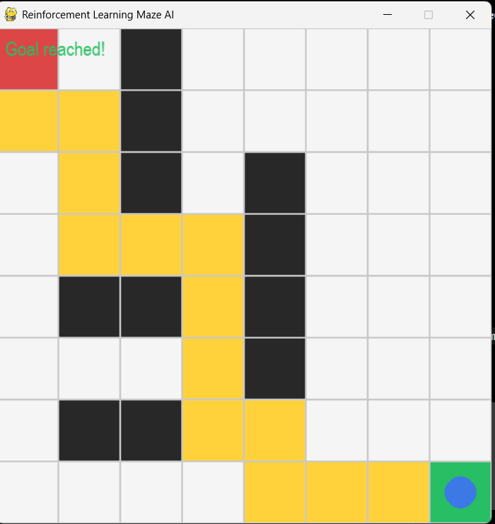

# Reinforcement Learning Game AI

## 📌 Project Overview
This project uses Reinforcement Learning to train an AI agent to navigate a maze and learn suitable actions through rewards and penalties.

## 🎯 Objectives
- Build a maze game environment.
- Train an AI agent to learn through interaction.
- Apply reinforcement learning concepts.
- Visualize the agent's performance.

## 🧠 Technologies Used
- Python
- Reinforcement Learning
- NumPy
- Matplotlib (if used)

## ⚙️ How It Works
1. Initialize the maze environment.
2. Let the agent observe its current state.
3. Select actions using the implemented learning algorithm.
4. Give rewards or penalties based on the result.
5. Update the agent's policy or Q-table.
6. Repeat training to improve performance.

## 📸 Game Screenshot


## 🚀 How to Run
1. Clone this repository.
2. Install the required dependencies.
3. Run the training script.
4. Run the game script.

Update the filenames in these instructions to match the actual files in your repository.

## 📂 Project Structure
```text
Reinforcement-Learning-Game-AI/
├── screenshots/
│   └── maze_game.png
├── train.py
├── README.md
└── requirements.txt
```

## 👩‍💻 Author
GitHub: [prabhuti256-collab](https://github.com/prabhuti256-collab)

Intern ID- CITS9069

